# iDrive Plus — MINI Plus · BMW Plus · Supra Plus

🇮🇹 [Leggi in italiano](README.md)

Weather, news, local news, fuel prices and traffic **inside iDrive** on cars with the
**NBT EVO (ID6)** head unit, without changing any control unit and without touching Android Auto.

The head unit has no internet of its own: the phone app downloads the data (over the phone's data connection)
and hands it to iDrive over the wireless Android Auto Wi-Fi. The iDrive plugins ask the app for ready-made pages
(port 8765) and update themselves.

| Car | App | Colour |
|---|---|---|
| MINI (F5x / F60) | MINI Plus | light blue |
| BMW with NBT EVO | BMW Plus | yellow |
| Toyota GR Supra (J29) | Supra Plus | red |

One codebase for all three: only the name, icon, colour and the car's name in the texts change.

> **Status:** tested on a MINI F60 (8.8" screen). On BMW and Supra these still need checking on a real car:
> the online-services menu where the entries appear, the car's Bluetooth name and, for the 10.25" screen
> (1440×540), the page calibration.

## Requirements
- NBT EVO head unit with **root SSH** access.
- **Wireless Android Auto** on the head unit ([Sq00ky's nbt-aad](https://github.com/Sq00ky/Supra-iDrive6-Android-Auto)):
  the phone must be on the car's Wi-Fi.
- Android 8 or later on the phone.

## Features
- **Weather** (open-meteo.com; MET Norway when it does not answer) with the **Italian Civil Protection warnings** for the municipality you are in. Updated every hour and at once when you enter another municipality.
- **National news** and **local news** for a chosen city (ANSA RSS feeds), with thumbnails.
- **Fuel stations** nearby with official MIMIT (Osservaprezzi) prices and the brand logo.
- **Traffic** nearby (Autostrade per l'Italia).
- **Vehicle status** in iDrive: the summary (range, litres in the tank, odometer, average consumption, the current trip, temperatures) and the **Doors, windows and roof** page with a photo of the car and one state for each door, window, roof, tailgate and bonnet. The photo and its anchor points are set in the app.
- **Where I parked**: when the phone disconnects from the car's Bluetooth, the position is saved.
- The app starts by itself with the car's Bluetooth and stops when you get out.
- **Trip**: while driving and then in the parking box, start place, duration, distance, fuel used and left, temperatures and openings (doors, windows, roof). The car data is read by the Meteo plugin inside iDrive (read only) and sent to the app over the car's Wi-Fi: no AAIdrive, no extra Bluetooth link.
- **Trip history**: every finished trip with start and end place, duration, distance, fuel used and km/l; the monthly summary.
- **Refuels**: detected on their own when the tank level goes up, with litres, place and, if you were at a station in the MIMIT list, brand, price and estimated cost.
- **Openings alert**: if you get out with a window, the roof, the tailgate or the bonnet open, the phone shows a notification.
- **My cars**: several cars, each recognised by its Bluetooth name, with its own name in the app (e.g. "Lucy" instead of "MINI12345", display only), fuel and parking spot. They add themselves on first connection, or from the cars paired with the phone.

Data sources are Italian, so the news, fuel and traffic sections are for Italy; the weather works anywhere.

## What it looks like
| In the car (MINI F60, 8.8" screen) | On the phone |
|---|---|
| 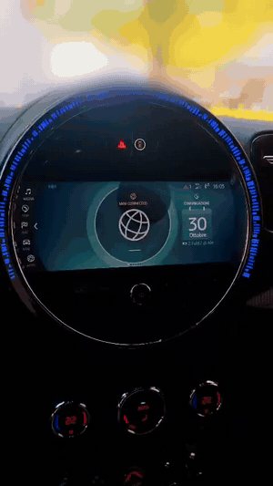 | 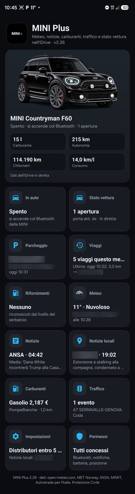 |
| MINI Connected menu and the five pages. [Video (MP4, 30 s)](docs/idrive_mini.mp4) | MINI Plus (NBT Plus looks the same): car photo with fuel, range, km and consumption, then the sections two per row |

The app sections:

| | | | |
|---|---|---|---|
| 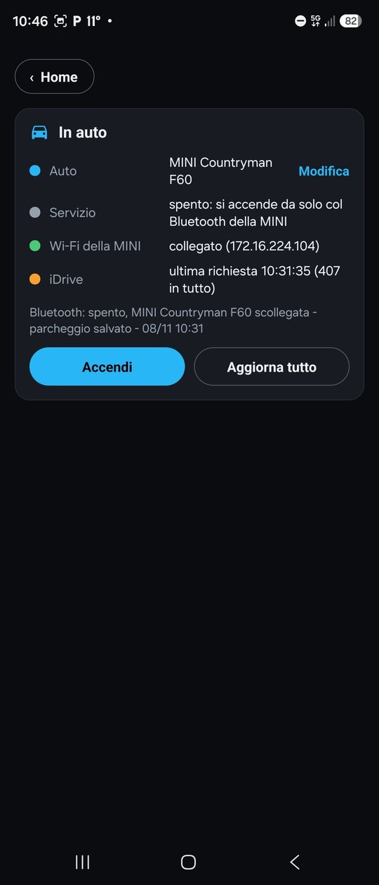<br>In the car | 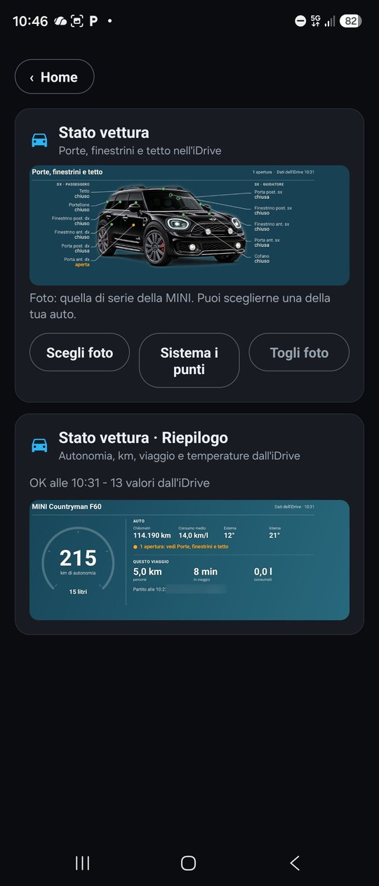<br>Vehicle status | 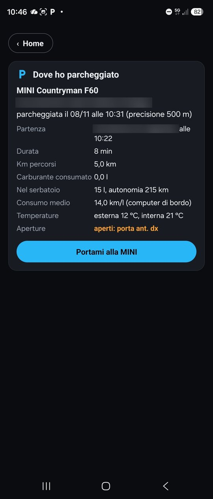<br>Parking | 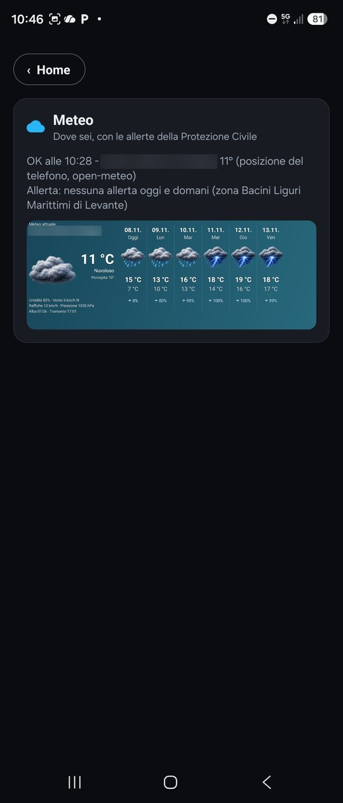<br>Weather |
| 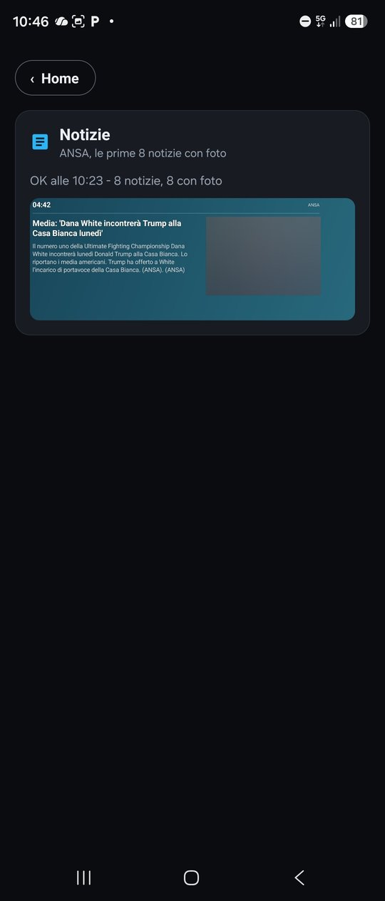<br>News | 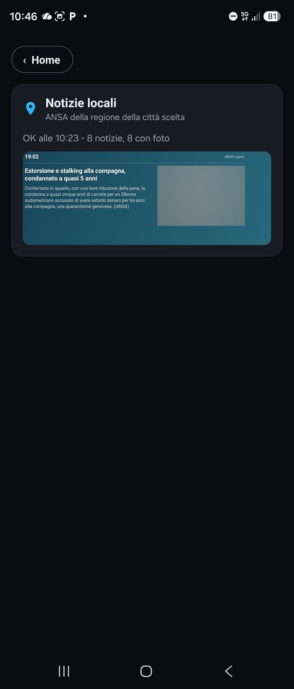<br>Local news | 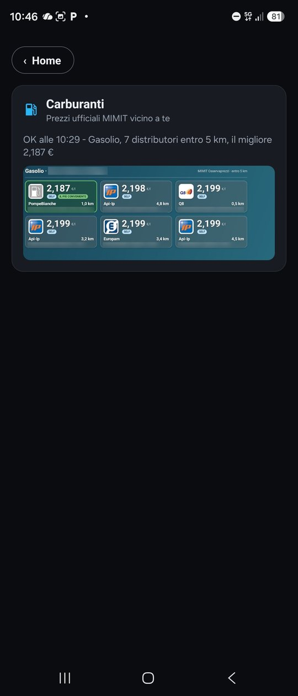<br>Fuel | 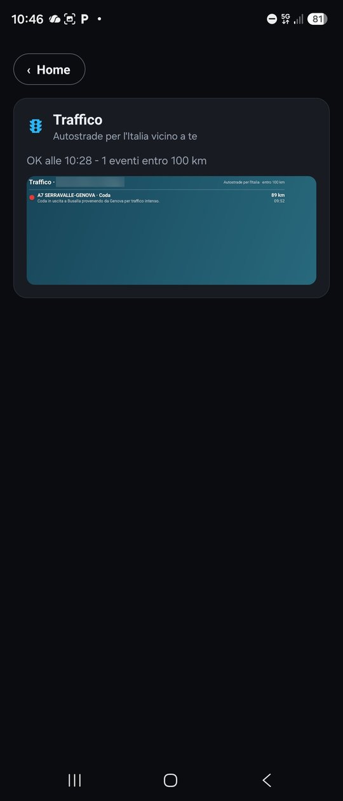<br>Traffic |
| 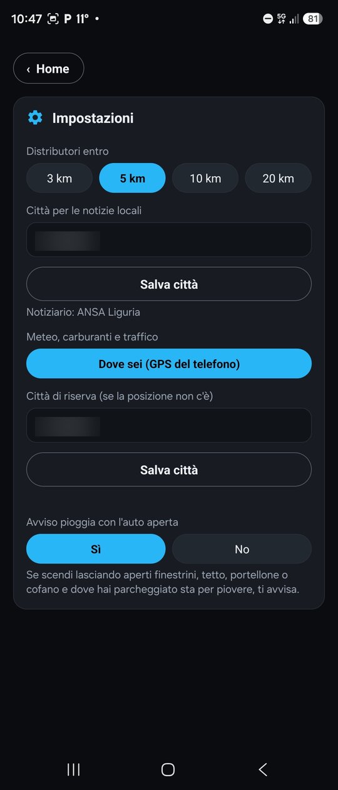<br>Settings | 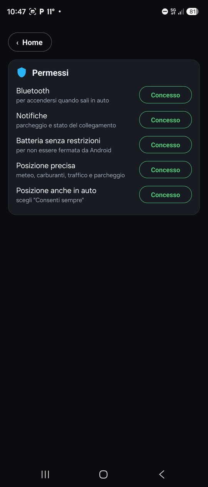<br>Permissions | | |

Addresses, town and windscreen are blurred out; news photos are blurred.

## Layout
```
app/        Android app (Kotlin, no external libraries) - flavors mini / bmw / supra
plugin/     source of the six iDrive plugins (C++ without the standard library, ARM/QNX)
chiavetta/  USB-stick install scripts, plugin descriptions, per-brand "waiting" pages
```

## Building
**App**
```
cd app
./gradlew assembleRelease          # app/build/outputs/apk/{mini,bmw,supra}/release/
./gradlew testMiniDebugUnitTest    # tests + sample pages in app/app/build/pagine/mini/
```
**Plugins** — see `plugin/compila.sh`. The HMI libraries (`libAppFramework.A.so`,
`libCoreFramework.A.so`) are not in the repository: copy them from your own head unit.

## Installing
The APKs and the USB-stick zip are in the **Releases**. Step-by-step instructions in
[`chiavetta/README-v27.txt`](chiavetta/README-v27.txt); in short, on the head unit shell:
```
mount -o remount rw /net/hu-omap/fs/sda0
on -f /net/hu-omap/ /bin/sh
sh /mnt/umass*/00-installa.sh mini     # or bmw, or supra
```
Then restart the head unit (hold the power button for 30 seconds). To remove everything: `sh /mnt/umass*/10-togli.sh`.

## Data sources
open-meteo.com · MET Norway (CC BY 4.0) · ANSA (RSS feeds) · MIMIT Osservaprezzi carburanti · Autostrade per l'Italia ·
Dipartimento della Protezione Civile (criticality bulletins, CC BY-SA 4.0).
The app reads the data live, on the phone; the repository does not contain it
(except one sample bulletin for the tests).

## License
[PolyForm Noncommercial 1.0.0](LICENSE.md), the same as nbt-aad: free to use, change and share for
non-commercial purposes. Selling it, or bundling it with anything sold, is not permitted.

Required Notice: Copyright (c) 2026 DeathWalkeR - iDrive Plus (https://github.com/deathwalker80/idrive-plus)

## Notes
Personal project, not affiliated with MINI, BMW or Toyota: the brand names belong to their owners and only say
which cars it works with. Use at your own risk.
