# iDrive Plus — MINI Plus · BMW Plus · Supra Plus

🇬🇧 [Read in English](README.en.md)

Meteo, notizie, notizie locali, carburanti e traffico **dentro l'iDrive** delle auto con testata
**NBT EVO (ID6)**, senza modificare nessuna centralina e senza toccare Android Auto.

La testata non ha internet suo: i dati li scarica l'app del telefono (connessione dati del telefono)
e li passa all'iDrive sul Wi-Fi di Android Auto wireless. I plugin nell'iDrive chiedono le pagine pronte
all'app (porta 8765) e si aggiornano da soli.

| Auto | App | Colore |
|---|---|---|
| MINI (F5x / F60) | MINI Plus | azzurro |
| BMW con NBT EVO | BMW Plus | giallo |
| Toyota GR Supra (J29) | Supra Plus | rosso |

Stesso codice per tutte e tre: cambiano solo nome, icona, colore e il nome dell'auto nei testi.

> **Stato:** provato sulla MINI F60 (schermo 8,8"). Su BMW e Supra resta da verificare sull'auto vera
> il menu dei servizi online in cui compaiono le voci, il nome Bluetooth dell'auto e, per lo schermo
> da 10,25" (1440×540), la calibrazione delle pagine.

## Cosa serve
- Testata NBT EVO con accesso **SSH root**.
- **Android Auto wireless** sulla testata ([nbt-aad di Sq00ky](https://github.com/Sq00ky/Supra-iDrive6-Android-Auto)):
  il telefono deve stare sul Wi-Fi dell'auto.
- Telefono Android 8 o successivo.

## Funzioni
- **Meteo** (open-meteo.com; se non risponde, MET Norway) con le **allerte della Protezione Civile** per il comune in cui ti trovi. Si aggiorna ogni ora e subito quando passi in un altro comune.
  Nell'iDrive i sei giorni (oggi e i 5 seguenti) si scelgono con la manopola e la pagina evidenzia quello scelto; premendo si apre il giorno con massima, minima e percepita, pioggia (probabilità e mm), vento e raffiche, umidità, indice UV, alba e tramonto, e il giorno ora per ora (oggi le prossime 8 ore, gli altri giorni ogni 3 ore).
- **Notizie** nazionali e **notizie locali** della città scelta (feed RSS ANSA). Nell'iDrive sono "in primo piano": a destra le otto notizie, girando la manopola a sinistra compare quella scelta in grande (foto, ora, titolo, inizio del testo); premendo si apre.
- **Carburanti** vicini con prezzi ufficiali MIMIT (Osservaprezzi) e logo del marchio. Il distributore si sceglie con la manopola; premendo si apre la sua scheda con indirizzo, distanza, differenza dalla media dei vicini e tutti i prezzi.
- **Traffico** vicino (Autostrade per l'Italia).
- **Stato vettura** nell'iDrive: il Riepilogo (autonomia, litri nel serbatoio, chilometri, consumo medio, il viaggio in corso, temperature) e la pagina **Porte, finestrini e tetto** con la foto dell'auto e uno stato per ogni porta, finestrino, tetto, portellone e cofano. La foto e i suoi punti si scelgono nell'app.
- **Dove ho parcheggiato**: quando il telefono si scollega dal Bluetooth dell'auto salva la posizione.
- L'app si accende da sola col Bluetooth dell'auto e si spegne quando scendi.
- **Pagine leggere**: le pagine per l'iDrive partono in PNG a 256 colori, da 3 a 4 volte più piccole e uguali a vista, così arrivano e si aprono prima (Impostazioni → Immagini per l'iDrive: Leggere o Piene).
- **Pagine pronte prima di salire**: circa ogni ora, anche lontano dall'auto, meteo, notizie, carburanti e traffico si aggiornano da soli e restano salvati nel telefono, così l'iDrive li ha subito (Impostazioni: Sì, Solo Wi-Fi o No). Finché l'iDrive non manda i dati nuovi, Stato vettura mostra gli ultimi letti, con la loro data.
- **Viaggio**: mentre guidi e poi nel riquadro del parcheggio, partenza, durata, km percorsi, carburante consumato e nel serbatoio, temperature e aperture (porte, finestrini, tetto). I dati dell'auto li legge il plugin Meteo nell'iDrive (sola lettura) e li manda all'app sul Wi-Fi dell'auto: niente AAIdrive, nessun Bluetooth in più.
- **Storico viaggi**: ogni viaggio finito con partenza e arrivo, durata, km, carburante consumato e km/l; il riassunto del mese.
- **Rifornimenti**: riconosciuti da soli quando sale il livello del serbatoio, con litri, posizione e, se eri a un distributore dell'elenco MIMIT, marchio, prezzo e spesa stimata.
- **Avviso aperture**: se scendi con un finestrino, il tetto, il portellone o il cofano aperti arriva una notifica sul telefono.
- **Le mie auto**: più auto, ognuna riconosciuta dal suo nome Bluetooth, col suo nome nell'app (es. "Lucy" invece di "MINI12345", solo visivo), il suo carburante e il suo parcheggio. Si aggiungono da sole al primo collegamento, o dalle auto associate al telefono.

## Come si vede
| In auto (MINI F60, schermo 8,8") | Sul telefono |
|---|---|
| 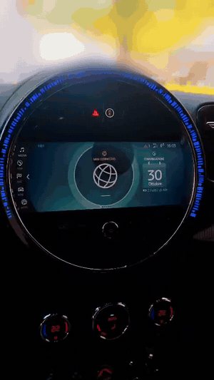 | 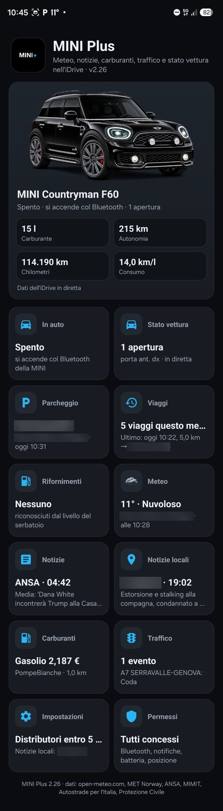 |
| Menu MINI Connected e le cinque pagine. [Video (MP4, 30 s)](docs/idrive_mini.mp4) | MINI Plus (NBT Plus è uguale): foto dell'auto con carburante, autonomia, km e consumo, poi le sezioni due per riga |

Le sezioni dell'app:

| | | | |
|---|---|---|---|
| 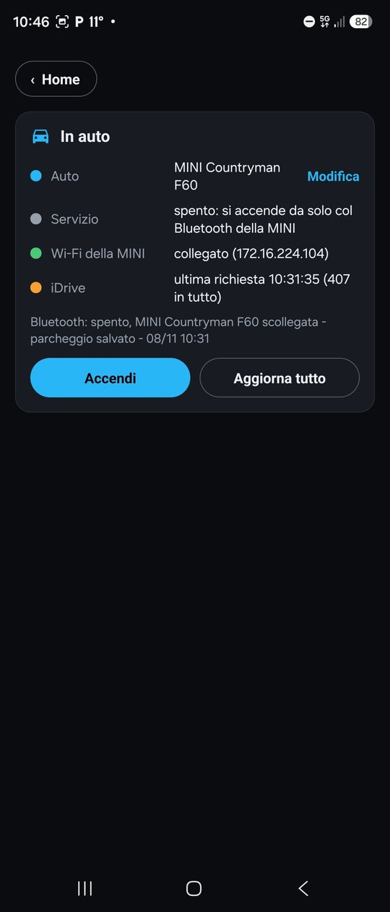<br>In auto | 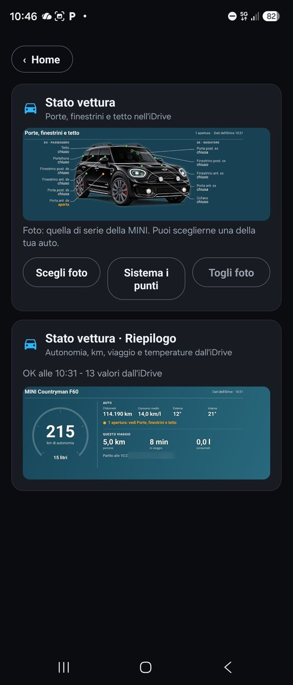<br>Stato vettura | 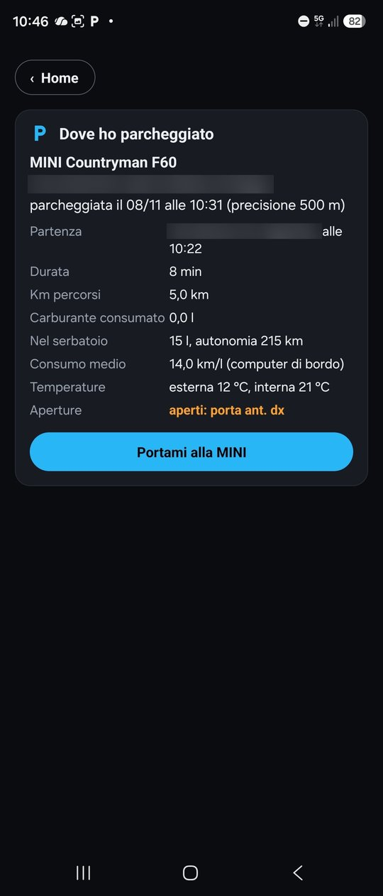<br>Parcheggio | 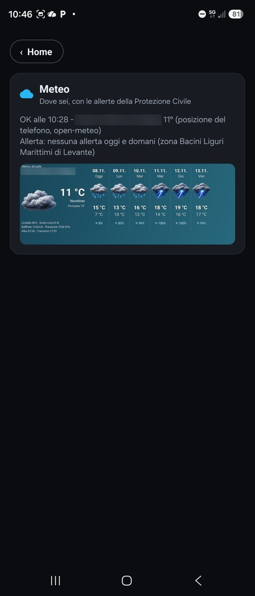<br>Meteo |
| 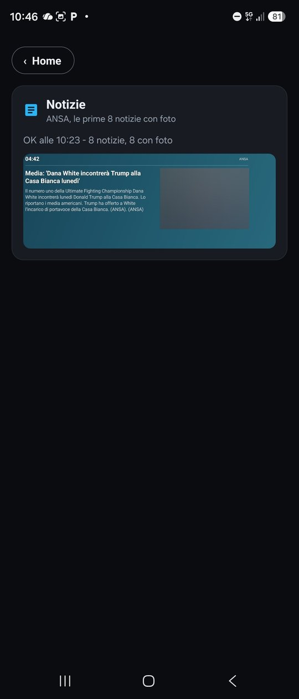<br>Notizie | 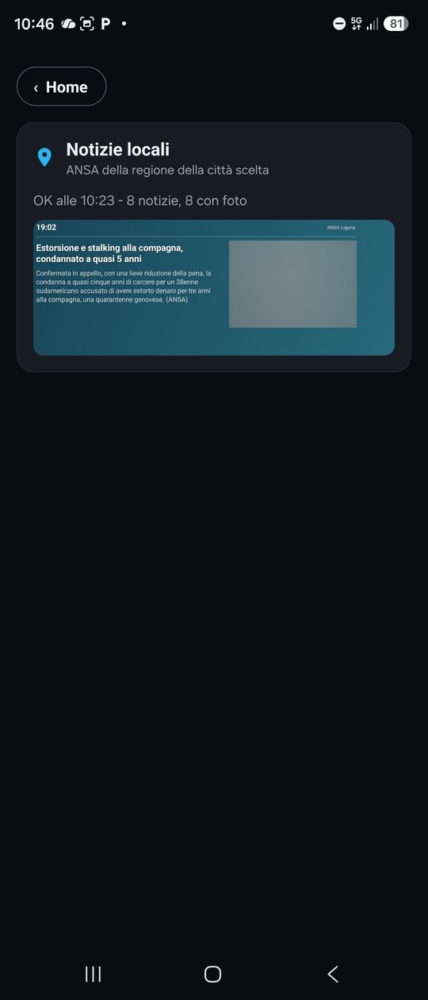<br>Notizie locali | 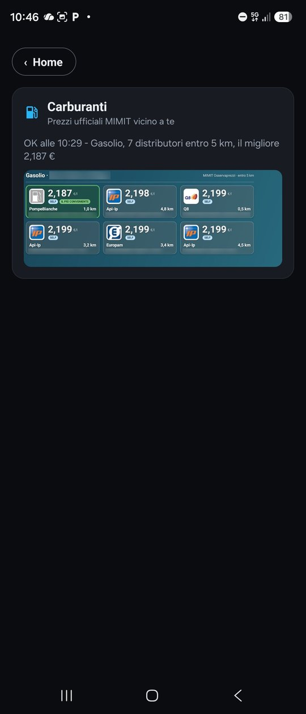<br>Carburanti | 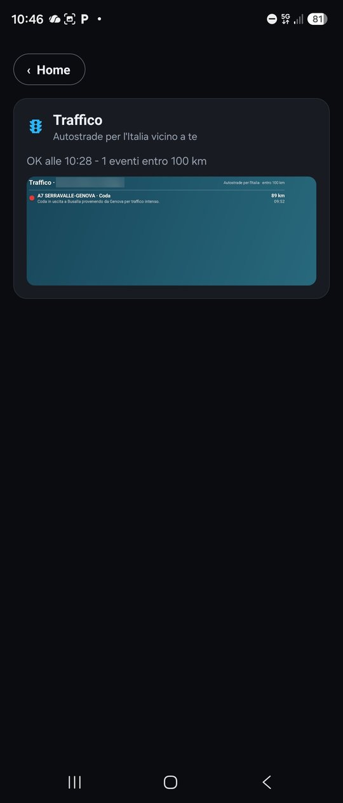<br>Traffico |
| 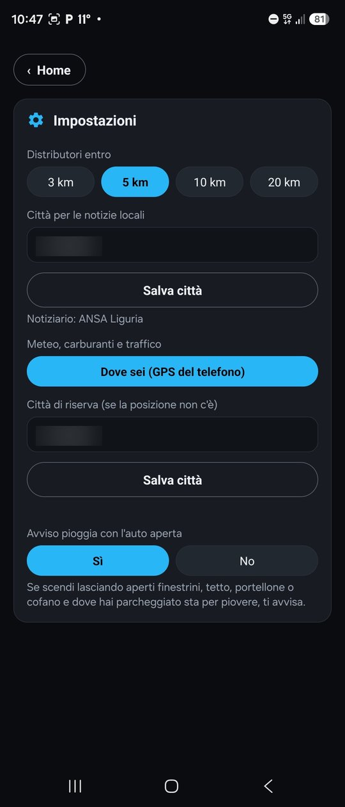<br>Impostazioni | 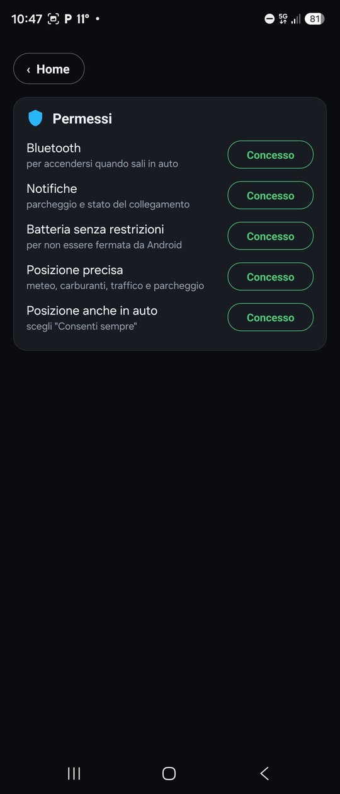<br>Permessi | | |

Indirizzi, comune e parabrezza sono oscurati; le foto delle notizie sono sfocate.

## Struttura
```
app/        app Android (Kotlin, nessuna libreria esterna) - flavor mini / bmw / supra
plugin/     sorgente dei sei plugin iDrive (C++ senza libreria standard, ARM/QNX)
chiavetta/  script di installazione, descrizioni dei plugin, pagine "in attesa" per marca
```

## Compilare
**App**
```
cd app
./gradlew assembleRelease          # app/build/outputs/apk/{mini,bmw,supra}/release/
./gradlew testMiniDebugUnitTest    # test + pagine di prova in app/app/build/pagine/mini/
```
**Plugin** — vedi `plugin/compila.sh`. Le librerie dell'HMI (`libAppFramework.A.so`,
`libCoreFramework.A.so`) non sono nel repository: vanno copiate dalla propria testata.

## Installare
Le APK e lo zip della chiavetta sono nelle **Release**. Istruzioni passo passo in
[`chiavetta/README-v28.txt`](chiavetta/README-v28.txt); in breve, sulla shell della testata:
```
mount -o remount rw /net/hu-omap/fs/sda0
on -f /net/hu-omap/ /bin/sh
sh /mnt/umass*/00-installa.sh mini     # oppure bmw, oppure supra
```
Per togliere tutto: `sh /mnt/umass*/10-togli.sh`.

## Fonti dei dati
open-meteo.com · MET Norway (CC BY 4.0) · ANSA (feed RSS) · MIMIT Osservaprezzi carburanti · Autostrade per l'Italia ·
Dipartimento della Protezione Civile (bollettini di criticità, CC BY-SA 4.0).
I dati vengono letti dall'app al momento, sul telefono; il repository non li contiene
(salvo un bollettino di esempio per i test).

## Licenza
[PolyForm Noncommercial 1.0.0](LICENSE.md), la stessa di nbt-aad: uso, modifiche e condivisione liberi
per scopi non commerciali. Venderlo, o includerlo in qualcosa che si vende, non è permesso.

Required Notice: Copyright (c) 2026 DeathWalkeR - iDrive Plus (https://github.com/deathwalker80/idrive-plus)

## Note
Progetto personale, non collegato a MINI, BMW o Toyota: i nomi delle marche sono dei rispettivi proprietari
e indicano solo con quali auto funziona. Si usa a proprio rischio.
